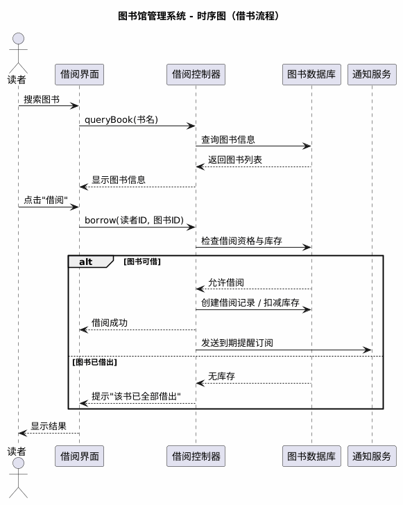
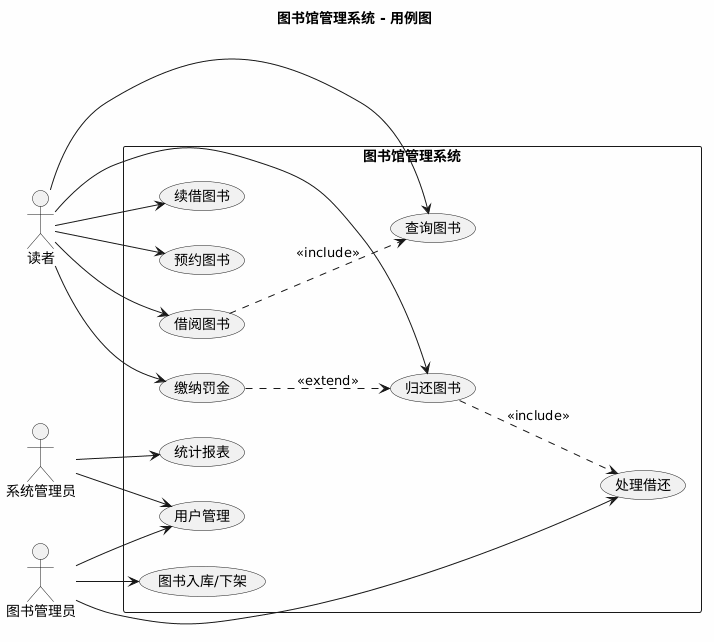
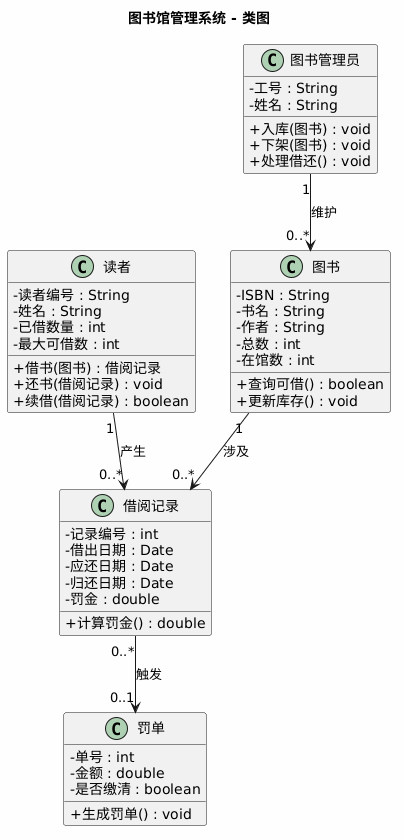
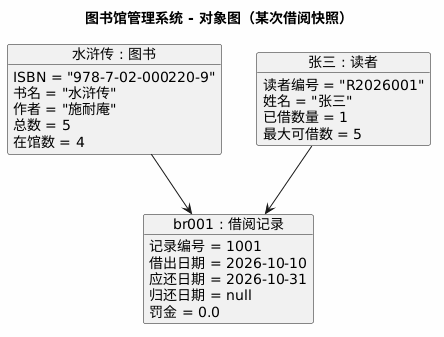
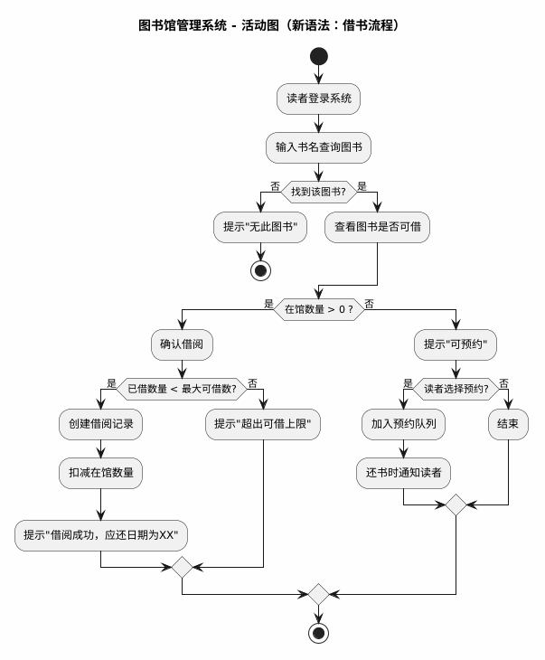
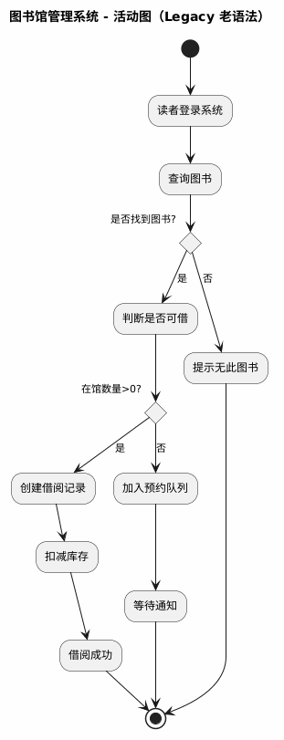
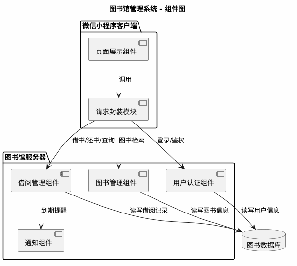
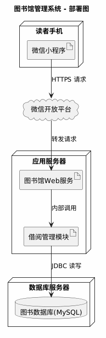
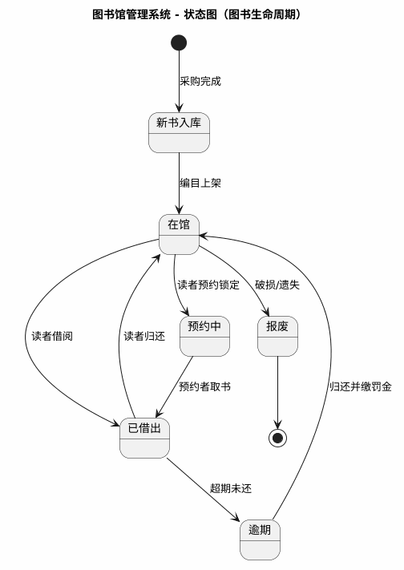
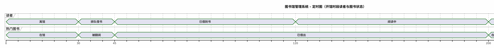

## 第一部分：猫眼电影微信小程序修改密码事件流描述

**用例名称**：用户修改登录密码
**涉及参与者**：普通用户、微信小程序客户端、后台服务器
**前置条件**：用户已正常登录该微信小程序，且网络连接正常。

### 1. 主事件流（基本流 / 成功场景）

1. **触发操作**：用户在“我的”页面中点击“设置”，在设置列表中选择“账号与安全”选项。
2. **展示页面**：系统加载并展示“账号与安全”页面，其中包含“修改密码”功能入口。
3. **选择操作**：用户点击“修改密码”按钮。
4. **身份验证**：系统跳转至身份验证页面，要求用户输入**原密码**（或使用手机验证码进行辅助验证）。
5. **提交验证**：用户输入原密码并点击“下一步”。
6. **系统校验**：客户端将原密码发送至后台服务器进行校验。
7. **进入修改**：服务器校验原密码正确，返回验证通过指令；系统跳转至“设置新密码”页面。
8. **输入新密码**：用户输入**新密码**，并在确认框中**再次输入新密码**，随后点击“确认提交”。
9. **前端校验**：系统前端校验两次输入的新密码是否一致，以及密码格式（如：长度8-20位，包含字母和数字）是否符合规范。
10. **更新数据**：前端校验通过后，将新密码加密发送至服务器；服务器更新数据库中该用户的密码信息。
11. **操作完成**：服务器返回更新成功的响应。
12. **状态重置**：系统提示用户“密码修改成功，请重新登录”，并强制清除当前登录状态（Token），自动跳转至登录页面。

---

### 2. 备选事件流（异常流 / 扩展场景）

**备选流 A：原密码输入错误（对应主事件流第 6 步）**
*   A1. 服务器校验发现原密码不匹配，返回错误提示。
*   A2. 系统提示“原密码错误，请重新输入”，并清空原密码输入框，停留在当前页面让用户重试。
*   A3. 若用户连续 5 次输入原密码错误，系统触发安全机制，暂时锁定该账号的修改权限 15 分钟（或强制要求使用手机验证码找回）。

**备选流 B：新密码格式不合规或两次输入不一致（对应主事件流第 9 步）**
*   B1. 若两次输入的新密码不一致，系统提示“两次输入的密码不一致，请重新输入”，清空确认密码输入框。
*   B2. 若新密码格式不符合规范（如纯数字、长度不够），系统提示“密码需包含字母和数字，且长度为8-20位”，要求用户重新输入。
*   B3. 若新密码与原密码相同，系统提示“新密码不能与原密码相同”，要求用户重新输入。

**备选流 C：网络或服务器异常（对应主事件流第 10 步）**
*   C1. 在提交新密码时，若发生网络断开或服务器无响应。
*   C2. 系统提示“网络繁忙，请稍后重试”或“系统维护中”，并保留用户输入的表单信息，以便网络恢复后再次提交。

**备选流 D：用户中途取消操作（对应主事件流任意步骤）**
*   D1. 用户在修改密码的任意步骤中，点击左上角“返回”或系统“取消”按钮。
*   D2. 系统直接退出当前修改密码流程，返回上一级页面，且不保存任何已输入的数据。

**后置条件**：
*   **成功时**：用户密码更新成功，当前设备退出登录，用户需使用新密码重新登录。
*   **失败时**：用户密码保持原样，系统状态不变。

## 第二部分：图书馆管理系统 UML 图
1. 时序图（Sequence diagram）—— 借书流程

2. 用例图（Use case diagram）

3. 类图（Class diagram）

4. 对象图（Object diagram）—— 某次借阅快照

5. 活动图（Activity diagram，新语法）—— 借书流程

6. 活动图（Activity diagram，Legacy 老语法）

7. 组件图（Component diagram）

8. 部署图（Deployment diagram）

9. 状态图（State diagram）—— 图书生命周期

10. 定时图（Timing diagram）—— 开馆时段读者与图书状态
